<a href="https://github.com/joaosnet/joaosnet">
  <picture>
    <source media="(prefers-color-scheme: dark)" srcset="https://raw.githubusercontent.com/joaosnet/joaosnet/main/dark_mode.svg">
    
  </picture>
</a>

<pre>
<b># Language / Idioma</b>
$ <a href="./README.pt-br.md">cat README.pt-br.md</a>  # 🇧🇷 Português

<b>$ whoami</b>
João Natividade
Computer Engineering Student @ UFPA · Software Developer
Focus: Backend, distributed systems, signal processing and automation

<b>$ cat stack.txt</b>
Languages:  Python, Rust, TypeScript, JavaScript, Dart, C, SQL
Backend:    FastAPI, AWS, Docker, REST APIs, MCP
Systems:    ESP32, Linux, Canvas 2D, Three.js

<b>$ ./projects.sh</b>
[1] <a href="https://joaosnet.github.io/interactive-signals-and-systems/">Interactive Signals (120 FPS 3D Lab in the browser)</a>
[2] <a href="https://github.com/joaosnet/aethersense">AetherSense (Wi-Fi CSI sensing with ESP32 and Rust)</a>
[3] <a href="https://lapshub.github.io/dmovel_web_app/">DMóvel (Cross-platform assistive app in Flutter)</a>
[4] <a href="https://github.com/joaosnet/sigaa-ufpa-mcp">SIGAA MCP (Model Context Protocol server for academic automation)</a>
[5] <a href="https://joaosnet.github.io">Full portfolio</a>

<b>$ cat contact.txt</b>
Email:     <a href="mailto:joaodacruznatividade+carreira@gmail.com">joaodacruznatividade+carreira@gmail.com</a>
LinkedIn:  <a href="https://www.linkedin.com/in/joaonativi/">linkedin.com/in/joaonativi</a>
Website:   <a href="https://joaosnet.github.io">joaosnet.github.io</a>
</pre>
