<a href="https://github.com/joaosnet/joaosnet">
  <picture>
    <source media="(prefers-color-scheme: dark)" srcset="https://raw.githubusercontent.com/joaosnet/joaosnet/main/dark_mode.svg">
    
  </picture>
</a>

<pre>
<b># Language / Idioma</b>
$ <a href="./README.md">cat README.md</a>  # 🇺🇸 English

<b>$ whoami</b>
João Natividade
Estudante de Engenharia de Computação (UFPA) · Desenvolvedor de Software
Foco: Backend, sistemas distribuídos, processamento de sinais e automação

<b>$ cat stack.txt</b>
Linguagens:  Python, Rust, TypeScript, JavaScript, Dart, C, SQL
Backend:     FastAPI, AWS, Docker, REST APIs, MCP
Sistemas:    ESP32, Linux, Canvas 2D, Three.js

<b>$ ./projetos.sh</b>
[1] <a href="https://joaosnet.github.io/interactive-signals-and-systems/">Interactive Signals (Lab 3D a 120 FPS no navegador)</a>
[2] <a href="https://github.com/joaosnet/aethersense">AetherSense (Sensoriamento Wi-Fi CSI com ESP32 e Rust)</a>
[3] <a href="https://lapshub.github.io/dmovel_web_app/">DMóvel (Aplicativo multiplataforma assistivo em Flutter)</a>
[4] <a href="https://github.com/joaosnet/sigaa-ufpa-mcp">SIGAA MCP (Servidor MCP para automação acadêmica)</a>
[5] <a href="https://joaosnet.github.io">Portfólio completo</a>

<b>$ cat contato.txt</b>
E-mail:    <a href="mailto:joaodacruznatividade+carreira@gmail.com">joaodacruznatividade+carreira@gmail.com</a>
LinkedIn:  <a href="https://www.linkedin.com/in/joaonativi/">linkedin.com/in/joaonativi</a>
Site:      <a href="https://joaosnet.github.io">joaosnet.github.io</a>
</pre>
